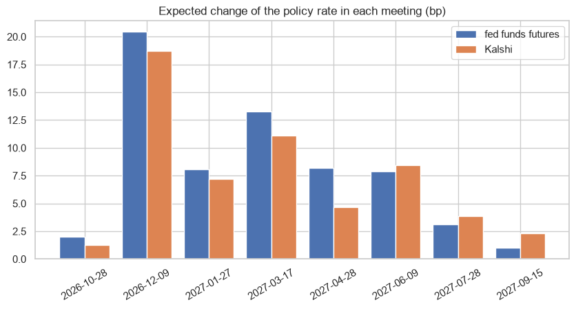

# Fed decision markets: Kalshi event contracts vs fed funds futures

Part of my Graduating Project at Rennes School of Business ("Two Markets for the Same State Price"). A Fed decision is an event. Here the event contract is the native instrument and the derivative (fed funds futures) is the indirect one, the opposite of a note written on a price level. Two questions:

1. **Calibration:** in the FOMC meetings already resolved, how good were the Kalshi probabilities 1, 7 and 30 days before the decision?
2. **Today:** do Kalshi and the fed funds futures (with the CME FedWatch method) give the same probabilities for the next meetings?

**Data:**
- Kalshi public API: series KXFEDDECISION, live and historical endpoints.
- Fed funds futures (CBOT ZQ, Yahoo Finance).
- Effective fed funds rate (FRED).

## Results
| Days before the meeting | Brier score of Kalshi |
|---|---|
| 1 | 0.022 |
| 7 | 0.090 |
| 30 | 0.144 |

For comparison, the naive forecasts score 0.643 ("the Fed does not move") and 0.714 ("the Fed repeats the last decision").

- **Calibration:** Kalshi is well calibrated close to the decision. One day before, the median probability of the outcome that happened is 97%.
- **Surprises:**
  - The biggest one is the 50 bp cut of September 2024: Kalshi gave it only 7% one week before.
  - The hike of September 2026 was better anticipated: 54% one week before and 87% one day before.
- **Today:** the two markets agree. The expected change in each meeting differs by 1.4 bp on average. Until September 2027 the futures price 64 bp of hikes, against 58 bp in Kalshi.
- **For the notes:** for a note that pays if the Fed hikes, the Kalshi contract pays exactly on the event. The futures only give the expected average rate of the month, so they leave a basis.



## How to run
```
pip install -r requirements.txt
jupyter notebook fed_markets.ipynb      # the Kalshi data used is saved in data/
```

---
Alejandro Lezcano Osorio | Rennes School of Business (MSc in Financial Data Intelligence) and Universidad EIA
